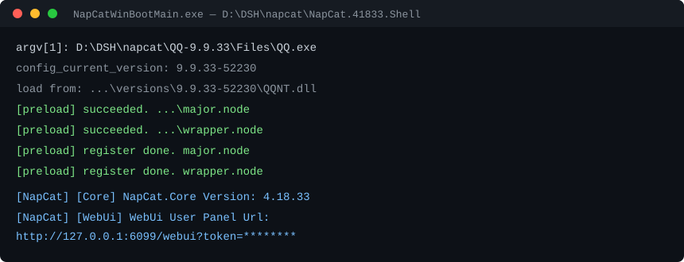

# napcat-qq-bridge

**把 QQ 接进 DSH：一份踩过坑的现场记录。**


QQ 客户端一直在更新，NapCat 的注入补丁必须和具体的 QQ 构建号对上。对不上时**不会报错**，而是静默失败：QQ 正常启动、界面正常，但 6099 没有 WebUI、3001 没有 OneBot，NapCat 的日志一行都不出——你会以为是自己配错了。

这份记录把「哪个版本配哪个」写死了。

## 版本对照（看这张表就够了）

| QQ | NapCat | 结果 | 判断依据 |
|---|---|---|---|
| **9.9.33-52230** | **4.18.33** | ✅ **能跑** | 四个 preload 全绿 + WebUI 6099 起来 |
| 9.9.33-52230 | 4.18.42 | ❌ worker fork 时 `error code v2:-8`，三次后主进程退出 | 注入进了，校验没过 |
| 9.9.33-52230 | 4.18.30 | ❌ 日志停在 `Process resumed` | 连版本识别都没到 |
| 9.9.37-54395 | 任何版本 | ❌ 版本表里没有这一档 | 注入不生效 |

判别方法：**看日志里有没有 `[NapCat] [Core] NapCat.Core Version`**。有，就是真跑起来了；只有 `[preload] succeeded` 而没有 Core 那行，就是注入成功但 NapCat 没接管。

## 成功长什么样



看到 `WebUi User Panel Url` 那一行（端口 6099，带 token），用浏览器打开它扫码登录——**扫的是这个页面上的码，不是 QQ 客户端自己弹出的登录窗**。扫错窗口会登录 QQ 本体，NapCat 完全不接管。

## 快速开始

```powershell
# 1. 独立 QQ 副本（不动系统装的那份），解压到 D:\DSH\napcat\QQ-9.9.33
# 2. NapCat Shell 解压到 D:\DSH\napcat\NapCat.41833.Shell
# 3. 启动（隐藏窗口，不占任务栏）
powershell -NoProfile -ExecutionPolicy Bypass -File D:\DSH\napcat\launch-napcat.ps1 -QQ <你的QQ号>
# 4. 打开日志里的 WebUI 地址扫码
# 5. 登录后配 config\onebot11_<QQ号>.json 的 websocketServers 到 127.0.0.1:3001
```

完整步骤、环境变量、桥接设置接口的全部参数在 [`SKILL.md`](./SKILL.md)。

## 十一个坑

摘要，细节在 SKILL.md：

1. QQ 单实例——系统里已有 QQ 在跑时，再启动副本会立刻退出
2. 别手改 `qqnt.json` 的 version/verHash
3. QQ 热更新会破坏组合
4. `launcher.bat` 靠注册表反推 QQ 路径
5. GitHub 直连不稳，用 `gh-proxy.com` 前缀
6. OneKey 安装器不能并发跑
7. 硬改 QQ 的 `package.json` 入口会触发完整性校验
8. `dbghelp` 劫持与 `QQNTPatcher` 对 9.9.33 无效
9. 硬杀 DSH 会清空 profile 的 `bundles`，插件全掉
10. Windows PowerShell 5.1 写 JSON 会带 BOM，DSH 解析不了
11. `file:` 安装的插件按 `files` 白名单裁剪，器官源码可能根本没装进去

## 适用边界

- 只针对 Windows 桌面环境；服务器无桌面请直接用 NapCat 的 Docker 镜像
- 是个人号的接法（OneBot / NapCat），不是官方机器人
- 版本组合是 2026-11 的快照，QQ 一升级就可能失效——先回来看那张对照表

## 许可

MIT。踩坑记录随便用，能替你省掉一个通宵就算没白写。
